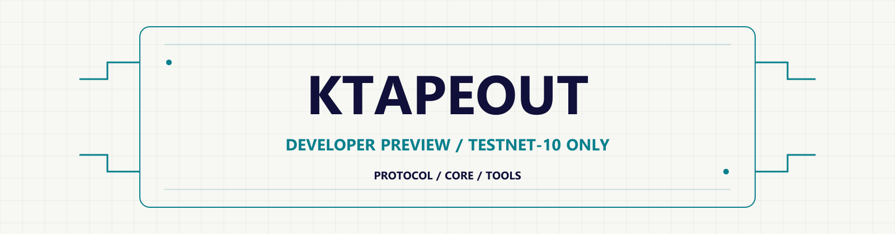

# KTAPEOUT 0.5.0 · Developer preview

<picture>
  <source media="(prefers-color-scheme: dark)" srcset="docs/assets/banner-dark.svg">
  
</picture>

KTAPEOUT connects application identity, reusable components, development tools, testing, and on-chain publication. This developer preview contains the protocol, Rust Core, tools, examples, and documentation for a limited Testnet-10 and local workflow.

[](docs/reference/capabilities-and-status.md) [](.github/workflows/ci.yml)

**Preview boundary:** Testnet-10 only · Not a security audit · Not a Mainnet release · **Review:** Codex author review (not independent). The security reporting channel is enabled but has not been tested end to end.

## Start here

Run these documented commands from the repository root. The starter workflow reports incomplete stages, and its test is structural only; neither runs application behavior.

```sh
cargo run --locked -p ktapeout-cli -- init --template StateMachine --network testnet-10 --output ./my-app
cargo run --locked -p ktapeout-cli -- dev workflow ./my-app/workflow.json
cargo run --locked -p ktapeout-cli -- app test ./my-app/source-manifest.json
```

## Verified capabilities

| Capability | Evidence level | What the evidence establishes |
|---|---|---|
| Build a deterministic application package locally |  | Repeated local builds produced the same package digest; no upload or publication. |
| Anchor and read back a Testnet-10 artifact root |  | Documented transactions; not rechecked online for this preview. The payload is not stored on chain. |
| Native registration authorization, signing, and assembly |  | Test fixtures and VM coverage; no live name-registration submission. |
| V6 name-registration reference assembly |  | Pinned VM and saved-vector checks; not an end-to-end CompactV1 registration. |

Evidence legend: `LOCAL_OK` = deterministic local evidence; `LIVE_TN10` = documented Testnet-10 evidence; `MOCK_OR_VM` = fixture or virtual-machine evidence.
See the full [capabilities and status matrix](docs/reference/capabilities-and-status.md) for scope and evidence details.

## Not included in this preview

- Studio, Browser SDK, or wallet providers.
- A name publication flow for developers.
- Namespace issuance or CompactV1 name registration for `ktape`, `ktapedemo`, or `ktapeout`.
- Payload storage adapters, including HTTPS, Arweave, Google Drive, or R2.
- A hosted demo or an online product. The `ktapeout.xyz` site has not been updated as part of this preview.

---

## Technical overview

**Developer preview · Testnet-10 only · Mainnet release: unavailable.** Not a security audit. Dependency audit is non-clean under disclosed, time-limited exceptions (see DEPENDENCY-AUDIT.md).

**GitHub:** [KTAPEOUT](https://github.com/kaspa-tapeout/ktapeout) · **Documentation:** [Developer documentation index](docs/index.md)

KTAPEOUT is an open application platform for Kaspa, built on the KTAPEOUT 0.5.0
protocol. This candidate provides protocol documentation, local Rust
Core/Verifier/CLI workflows and a Testnet-10 flow that anchors an artifact root
on chain (plan, sign with your own test key, submit, verify). The broader
platform connects application identity, reusable components, development,
testing and on-chain publication; this candidate does not package every adapter,
wallet provider or naming workflow needed for that end-to-end path.

```text
Broader platform: Design → Build → Test → Publish & Bind → Access
This candidate: Design → Scaffold → Inspect → Local validation → TN10 artifact-root publish and verify
```

- Scaffold a local application and inspect its Profile, locks, artifacts and
  unsigned workflow using the included Rust CLI.
- Compose Profiles, lock exact dependencies, and reuse Packages, Recipes and
  Runtimes where the candidate's documented commands support them.
- Protocol clients may provide read-only browsing without a wallet; each L1
  state change requires explicit user authorization through a selected provider.
  This candidate does not include a browser client or wallet provider.
- Validate local declarations and artifacts before preparing any external
  publication plan. The starter workflow does not execute application behavior.
- For TN10 artifact-root transactions, use the offline plan/sign and multi-node
  readback flow in the guide. Local developer signing is included; full naming
  publication and retention remain separate capabilities.
- Compatible HTTPS gateways or extensions can resolve the same canonical
  identity when separately implemented and deployed.

The CLI and structured outputs support human developers, automation, and AI.
Published interfaces let others build clients, gateways, components, and services.
Those clients are contract consumers, not protocol authorities: alternate
implementations must preserve the public schemas, vectors, hashes and evidence
labels, while provider, wallet and transport capabilities remain explicit.
The broader platform also develops Studio, Browser SDK, and application access
tools; these surfaces are not all included in this minimal candidate.

Start with [scaffolding and inspecting a local project](docs/getting-started/first-application.md),
[platform overview](docs/platform-overview.md), [capabilities and status](docs/reference/capabilities-and-status.md),
and [naming reference](docs/reference/naming.md).

## Scaffold a local project with AI

The fastest safe path is local and unsigned. You can give the
[KTAPEOUT Application Developer Skill](docs/ai/application-developer.md) to Codex,
Claude Code, GitHub Copilot, Cursor, Windsurf or another coding assistant,
then ask it to create the first scaffold from the public contracts.

1. Install Rust and clone this repository.
2. Open the repository root in your AI coding tool.
3. Use the included [public protocol guidance](docs/ai/README.md) for local work and read-only planning.
   Run `ktape tn10 sign` and `ktape tn10 submit` yourself; do not give an assistant a key file.
   The developer Skill is included; the [Operator Release Skill](docs/ai/application-engineering.md) is operator-only.
4. Ask the assistant to follow the included public contracts and plan before editing.
5. Run the local scaffold and workflow checks:

```powershell
$env:CARGO_TARGET_DIR = Join-Path $env:TEMP "ktapeout-0.5.0-target"
cargo run --locked -p ktapeout-cli -- init --template StateMachine --network testnet-10 --output .\my-app
cargo run --locked -p ktapeout-cli -- dev workflow .\my-app\workflow.json
```

```bash
export CARGO_TARGET_DIR="${TMPDIR:-/tmp}/ktapeout-0.5.0-target"
cargo run --locked -p ktapeout-cli -- init --template StateMachine --network testnet-10 --output ./my-app
cargo run --locked -p ktapeout-cli -- dev workflow ./my-app/workflow.json
```

The first Rust build compiles the Kaspa dependency graph. Expect roughly 5–15
minutes and about 1.5 GB of build output, depending on the machine; one serial
build plus tests measured about 11 minutes and 1.4 GB on a Windows development
machine. Setting `CARGO_TARGET_DIR` keeps compiled files outside the checkout
and lets later runs reuse them. The optional `just` command-line tool provides
`just check`, `just test`, `just lint`, `just audit` and `just demo`; the
equivalent Cargo commands are listed in [Contributing](CONTRIBUTING.md).

The assistant should explain the generated Profile, locks, artifact and
workflow before changing them. The starter's quickstart validation is
`STRUCTURE_ONLY` (`tests_executed: false`), and `ktape app test` returns
`STRUCTURE_ONLY` with ToolResult `WARNING`. The dev workflow reports
`INCOMPLETE`: check is `NEEDS_INPUT`, build is `PASS` with a `LOCAL_ONLY`
artifact, package is `REQUIRES_HUMAN_REVIEW`, and test is `STRUCTURE_ONLY`.
These results do not claim application behavior was executed or that the app is
publishable. Exit code 0 means the workflow command completed, not that all
stages passed. These commands do not
execute arbitrary application semantics. These scaffold commands do not sign,
broadcast, access a wallet or establish Mainnet status. Continue with the [first application
tutorial](docs/getting-started/first-application.md), then read the
[AI tool setup guide](docs/ai/ai-tool-installation-and-use.md) for tool-specific
instructions.

## Build your own entry into the ecosystem

Build an independent website, read-only explorer, client or developer tool
around KTAPEOUT Protocol 0.5.0. A `ktape://` URI identifies a network-scoped
application; your own HTTPS domain can provide an entry to that same identity.
You can also contribute reusable Profiles, Packages and Recipes, Runtime or
adapter integrations, and AI development tooling.

Read the [third-party participation and website guide](docs/guides/names-and-application-access.md)
for the integration flow, public contracts and current capability boundaries.
The public Rust Core/Verifier/CLI provides a starting point; web resolvers,
browser handlers and provider integrations require additional implementations.

Project-authored release code and documentation use the [MIT License](LICENSE).
Third-party components retain their own licenses. Network and service fees are separate.

This candidate contains the reviewed English developer documentation and the
release-shaped Rust Core/CLI source surface for KTAPEOUT Protocol 0.5.0. It is
intentionally limited to the reviewed public release surface.

Start at [docs/index.md](docs/index.md). The Rust implementation is under
[`core/`](core/README.md). The candidate includes a small set of public integration tests and excludes embedded
unit-test modules, other tests, wallets, keys, caches, build outputs, internal
deployment material and bilingual research/implementation plans.

The broader infrastructure workspace currently contains a Native-KAS adapter
and Namespace Registry compiler/genesis helpers. They are intentionally not
bundled here yet: their current build boundary includes separate adapter/vendor
sources and external signer handoff. This repository documents the contracts
and exposes the reviewed Core/Verifier/CLI path until those tools receive a
standalone English source and evidence review.

The selected public [TN10 Registry identity evidence](release-evidence/tn10/)
contains the manifest, Bridge trust anchor and corroborating readback needed to
locate the declared Testnet-10 root. It is public identity evidence only; it
does not grant signing, broadcast, consensus-finality or Mainnet authority.

AI-assisted development is covered by the public [KTAPEOUT Application Developer
Skill](docs/ai/application-developer.md) (default entry; the
[Operator Release Skill](docs/ai/application-engineering.md) is operator-only) and [tool setup
guide](docs/ai/ai-tool-installation-and-use.md). These instructions do not
grant signing, wallet, broadcast or Mainnet authority.

The English protocol text is the `NORMATIVE — SOLE ENGLISH SPECIFICATION` for
the 0.5.0 tag. Explanatory guides never override it.

See [CONTRIBUTING.md](CONTRIBUTING.md), [SECURITY.md](SECURITY.md),
[CHANGELOG.md](CHANGELOG.md), [DEPENDENCY-AUDIT.md](DEPENDENCY-AUDIT.md) and
[LICENSE](LICENSE) before integrating the candidate.

## Build a local runtime package

After scaffolding a project, create a deterministic local runtime package.
The scaffold does not create an entrypoint, so add your own `index.html` to
`my-app/site` first and create the output parent directory (`mkdir out`). The
packager reads `discovery/metadata.json` only under `--source`; move the generated
`my-app/discovery/metadata.json` into `my-app/site/discovery/metadata.json`.
`--application-uri` must match its `canonical_uri` (`demo/starter` for the starter):

```powershell
cargo run --locked -p ktapeout-cli -- package build `
  --source .\my-app\site --application-uri demo/starter `
  --entrypoint index.html --output .\out\my-app-package
```

```bash
cargo run --locked -p ktapeout-cli -- package build \
  --source ./my-app/site --application-uri demo/starter \
  --entrypoint index.html --output ./out/my-app-package
```

See the [runtime packaging guide](docs/guides/build-runtime-package.md) for
limits and output details. This local step does not publish a locator or
upload, sign, broadcast, or activate the package.

## Candidate boundary

This curated source preview targets TN10 and local generic protocol tooling.
The default `developer-signing` feature signs with a developer-supplied test key;
`tn10-network` supplies submission and verification. See the [TN10 guide](docs/guides/publish-on-tn10-with-ktape.md)
for offline key generation, test funds, key format, budgets and the approval display.
`--key-file` accepts a path, never key contents in argv; `--key-stdin` supports
hidden terminal input. Windows file ACLs cannot be automatically checked and
produce a warning only. Erasure covers tool-managed buffers and owned key objects,
not all copies in libraries or the operating system. Developers retain key custody.
TN10 observations completed: (1) one transaction through external-signature
import and (2) one transaction through `--key-stdin`; `utxos`, `locate` and
`verify` each had one read-only query against two public nodes. These are limited
observations, not broad compatibility claims. Built-in `--key-file` signing has
not been tested on real TN10. The two endpoints' operator independence, Linux
runtime behavior, macOS behavior and mainnet are unverified. This flow anchors an artifact root,
without publishing a name or guaranteeing retained content. Mainnet is rejected.
It includes `ktape package build` for deterministic local runtime packaging;
that command does not upload the package, publish a locator, sign, broadcast,
or activate an application.
It includes a developer-facing V6 reference-path name-registration preview;
end-to-end TN10 validation for existing CompactV1 namespaces is incomplete, and
`register-request` fails closed when required witness context is unavailable.
It does not include V6 Profile integration, Browser SDK, Studio, wallet providers,
hosted signing services or the complete engineering publication workflow. Mainnet readiness,
production retention and cross-device recovery are not release claims.
The dependency audit retains a disclosed, version-specific maintainer exception;
report vulnerabilities through GitHub private vulnerability reporting (see
SECURITY.md).

